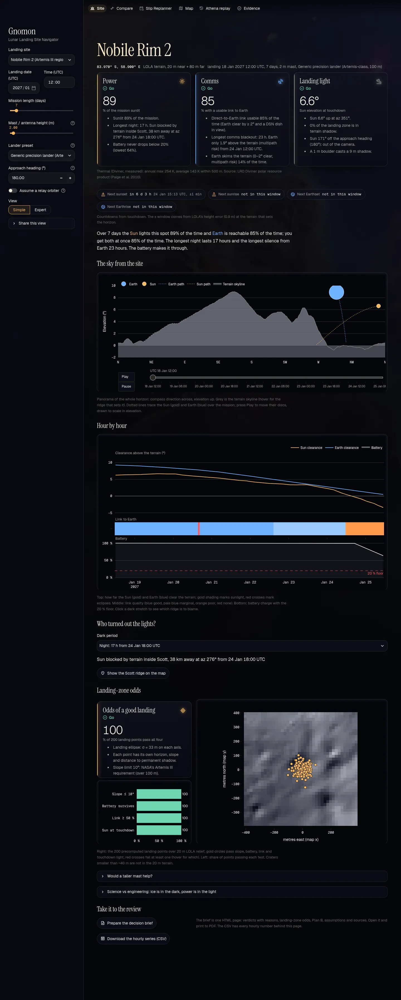
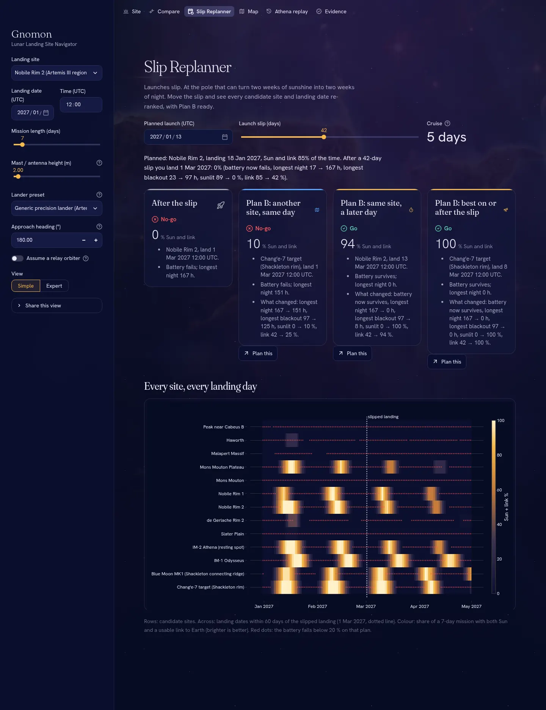
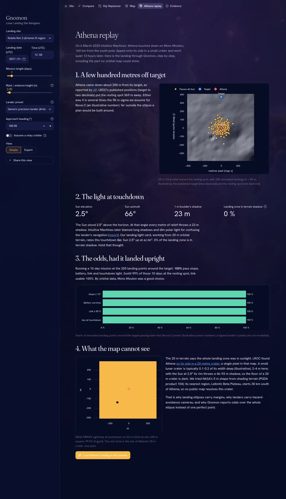
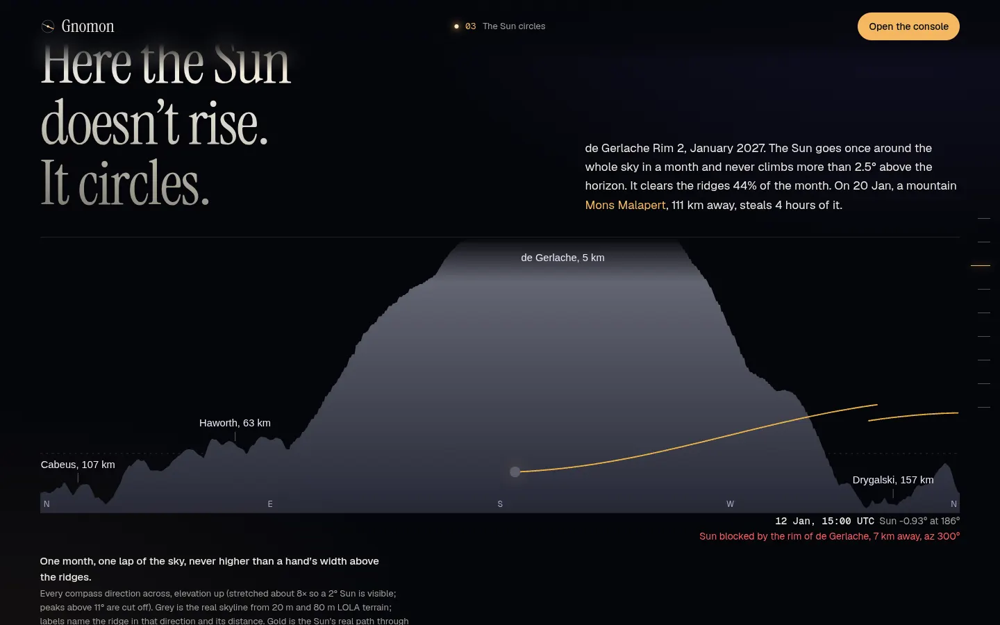
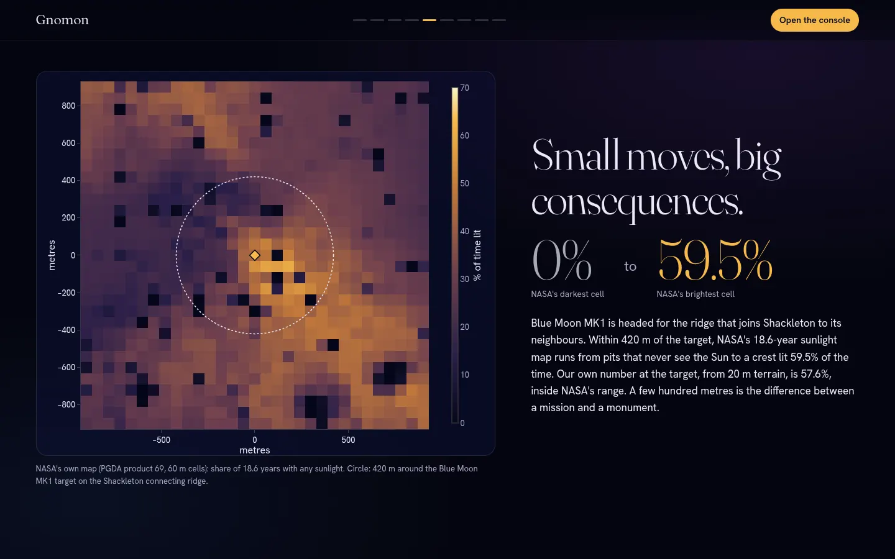

# Gnomon: Lunar Landing Site Navigator

NASA Space Apps 2026. At the Moon's south pole the Sun never climbs: it circles the horizon, a degree or two up, and a ridge 100 km away can switch your lander off. Earth bobs up and down with libration and drops behind the terrain for days. Gnomon tells you, for any site and landing time, when you will have sunlight and a line of sight to Earth, **which ridge is to blame** when you don't, how likely a good landing is across the whole landing ellipse, and **what to do when the launch slips**.

- **Story site:** https://anish-185.github.io/lunar-landing-site-navigator/ (scroll-driven, built on the same data)
- **Mission console:** the Streamlit app in `app/` (deploy steps below)
- **Method and known limits:** [`docs/METHOD.md`](docs/METHOD.md) · **Decisions log:** [`docs/DECISIONS.md`](docs/DECISIONS.md) · **Credits:** [`ATTRIBUTIONS.md`](ATTRIBUTIONS.md)



## What it does

| Page | What you get |
| --- | --- |
| **Site** | Power, Comms and Landing-light verdicts (icon + word + colour, with reasons); countdowns to the next sunset, sunrise, Earthset and Earthrise with an uncertainty window from LOLA's height error; a 360° sky panorama with the real terrain skyline and the Sun and Earth paths (press Play); an hour-by-hour timeline of clearance, link quality and battery; **blame the ridge** (click any dark stretch: "Sun blocked by Mons Malapert, 111 km away at az 94°", then show it on the map); **landing-zone odds** over 200 simulated landings, each with its own horizon and slope; mast-height curve; science vs engineering trade-off (distance to permanent shadow vs light); a one-page decision brief (HTML, print to PDF) and the hourly CSV. |
| **Compare** | Up to four site + date scenarios side by side, best value per row highlighted; "Equator vs pole" preset and a short explainer. |
| **Slip Replanner** | Launch date + cruise + slip → every candidate site × landing day re-ranked; Plan B cards (another site, same site later, best overall) with "what changed". |
| **Map** | NASA's long-run sunlight and Earth-visibility maps, permanently shadowed regions, every catalog site (click to plan it), and the ridge you picked. |
| **Athena replay** | IM-2's landing on 6 Mar 2025, step by step, including what 20 m orbital terrain cannot see (the 20 m crater Athena ended up in). |
| **Evidence** | Ephemeris vs JPL Horizons, our long-run sunlight vs NASA's maps, and a hindcast of four landers that flew. |

Custom latitude/longitude sites (80–90°S) work too, on the shipped 160 m DEM (labelled as coarser). The app makes no network calls.

## Validation

- **Ephemeris vs JPL Horizons:** 130 Sun/Earth positions (Apollo 11, Shackleton rim, Malapert across 2027; Athena's landing day): largest separation **0.004 arcsec**.
- **Long-run sunlight vs NASA's LOLA illumination maps (PGDA product 69):** 12 of 14 polar sites within 2.7 points of NASA's value; **13 of 14 inside NASA's own range within 420 m** of the site (the exception, Peak near Cabeus B, is explained by our finer 20 m near-field terrain). Earth: 12 of 14 inside, the two others within half a point.
- **Hindcast:** our first sunset after Chandrayaan-3's landing falls on 4 Sep 2023, the day ISRO shut Vikram down "at sunset over the landing site"; Blue Ghost 1's within ~2.5 h on a smooth-sphere horizon.

## How it works

Offline pipeline (`pipeline/`, conda, GDAL): NASA LOLA DEMs (20 m near field + 80 m far field) → terrain horizons at 720 azimuths with the vendored NASA-AMMOS MMGIS Sightline scripts → each blocking point named from the USGS Gazetteer; SPICE (DE440, `MOON_ME`, `azlcpo`) for Sun and Earth; 200 landing-ellipse points per site with their own horizons, slope and PSR distance. Compact results go to `data/derived/` (every file < 50 MB). The app (`app/`, Streamlit) and logic (`navigator/`, pure NumPy, tested) read only those files.

## Run it

Needs conda (Miniforge recommended).

```bash
make env                 # conda env "lunar-nav" (Python 3.11, GDAL from conda-forge)
conda activate lunar-nav
make data                # download NASA data into data/raw/ (~1 GB; 20 m DEMs are read remotely in windows)
make derived             # incremental precompute into data/derived/ (FORCE=1 rebuilds; first full run ~30 min)
make test                # pytest (network tests skipped; run them with pytest -m network)
make app                 # streamlit run app/Home.py
```

`data/derived/` is committed, so `make app` works straight after cloning (`pip install -r requirements.txt` is enough for the app alone). Story site: `cd site && npm ci && npm run dev`; `python -m pipeline.export_site` refreshes its data.

### Deploy the console to Streamlit Community Cloud

1. Sign in at https://share.streamlit.io with GitHub and click **Create app** → **Deploy a public app from GitHub**.
2. Repository `Anish-185/lunar-landing-site-navigator`, branch `main`, main file path `app/Home.py`.
3. **Advanced settings** → Python version **3.11**. No secrets. Click **Deploy** (first build ~3–5 min; it installs only `requirements.txt`).
4. Copy the app URL (e.g. `https://<name>.streamlit.app`) into `site/public/config.json` as `"appUrl"`, commit and push: the story site's Mission Console embeds it.

## Limits (short version)

Terrain smaller than ~40 m is invisible to the 20 m DEM (Athena's crater); comm-quality thresholds and lander power numbers are illustrative; hourly sampling; Artemis region centres are measured from NASA's map (a few km uncertainty). Full list in [`docs/METHOD.md`](docs/METHOD.md#known-limits).

## Screenshots

All pages and story chapters, desktop and mobile: [`docs/screenshots/`](docs/screenshots/).

| | |
| --- | --- |
|  |  |
|  |  |

## Team, credits, AI use

NASA Space Apps 2026 team: Anish G. Every library, dataset, image, font, vendored file and borrowed idea is in [`ATTRIBUTIONS.md`](ATTRIBUTIONS.md). **AI disclosure:** the code and text were written with Claude Code (Anthropic); the team directed, reviewed and tested it and is responsible for it.

Licensed under Apache-2.0 ([`LICENSE`](LICENSE)). Vendored MMGIS code keeps its Apache-2.0 license and NOTICE in `vendor/mmgis_sightline/`.
